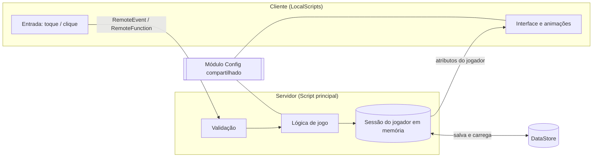
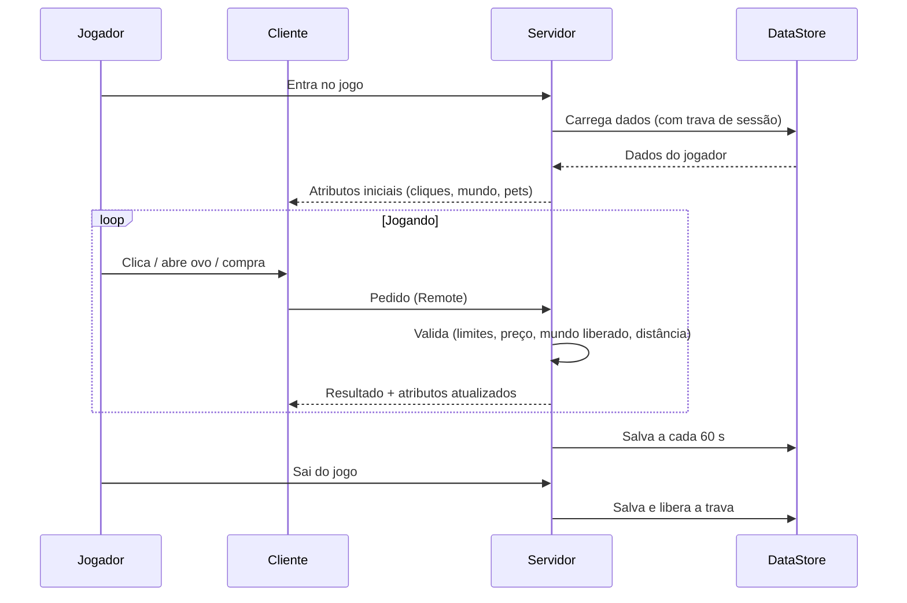
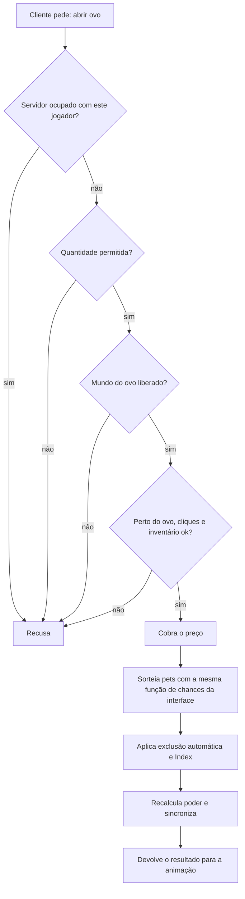
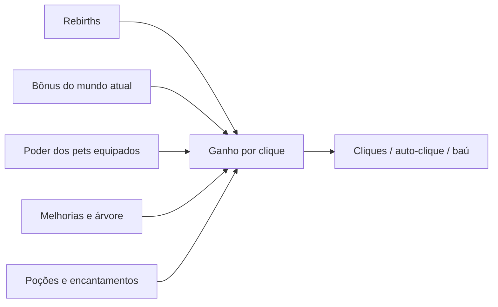
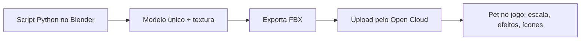

# 🏗️ Arquitetura

Visão de alto nível de como o jogo é organizado. Nomes e detalhes internos foram simplificados de propósito.

## 1. Princípio central: servidor autoritativo

O **cliente só mostra e pede**; quem **decide** é sempre o servidor. O cliente nunca diz "ganhei X cliques"
ou "tirei esse pet": ele diz "quero abrir este ovo" e o servidor confere tudo antes de responder.

## 2. Organização dos módulos

| Local | Papel |
| --- | --- |
| `ReplicatedStorage` → **Config** | Fonte única de verdade: pets, ovos, mundos, preços, chances, fórmulas de poder e de custo. Lido por cliente **e** servidor. |
| `ReplicatedStorage` → módulos de UI | Telas reutilizáveis (inventário, loja, árvore de habilidades, diária, configurações). |
| `ReplicatedStorage` → modelos e ícones | Catálogos de modelos de pets, ícones normais e dourados. |
| `ServerScriptService` → **servidor principal** | Sessões, cliques, ovos, rebirth, mundos, loja, salvamento. |
| `ServerScriptService` → placares e extras | Placares globais e detalhes do mapa. |
| `StarterPlayerScripts` | Um LocalScript por tela ou sistema (cliques, pets, loja, portais, baú, placares...). |
| `Workspace` | Mapas, ovos, portais, placares e decoração. |

### Por que um Config compartilhado?
As **chances dos ovos** são calculadas por uma única função. O servidor a usa para sortear e o cliente a usa
para mostrar a porcentagem na tela, então o que o jogador vê é exatamente o que acontece.

## 3. Comunicação cliente ↔ servidor

- **RemoteFunction** para ações com resposta (abrir ovo, rebirth, comprar, equipar).
- **RemoteEvent** para avisos sem resposta (notificações, cliques, resultados de animação).
- **Atributos do jogador** para dados que a interface só precisa ler (cliques, gemas, mundo atual, bônus).
  O servidor escreve; o cliente apenas observa e atualiza a tela.
- Os remotes são **criados pelo servidor ao iniciar**, em um único ponto, e todos validam tipo e intervalo
  dos argumentos recebidos.

## 4. Fluxo principal de uma sessão

## 5. Fluxo de abertura de ovo

## 6. Cálculo de ganho

O bônus de mundo só vale em mundos que o jogador **já liberou**.

## 7. Dados e segurança

| Preocupação | Como é tratada |
| --- | --- |
| Perda ou duplicação de progresso | Trava de sessão ao salvar e carregar; falha no carregamento não deixa o jogador jogar "zerado". |
| Compras repetidas | Recibo idempotente: o mesmo recibo nunca entrega duas vezes. |
| Cliente adulterado | Servidor valida preço, distância, mundo liberado, taxa de cliques e propriedade dos itens. |
| Pets pagos ou trancados | Não podem ser consumidos por máquinas ou encantamento. |
| Estados travados | Operações críticas protegidas para sempre liberar o estado "ocupado". |
| Painel de desenvolvedor | Restrito a IDs autorizados e desligado na versão publicada. |

## 8. Pipeline de arte (fora do Roblox)

Os pets são gerados por parâmetros (cores, chifres, caudas, auréolas, etc.), o que permite criar novos pets
mantendo o mesmo estilo visual rapidamente.
